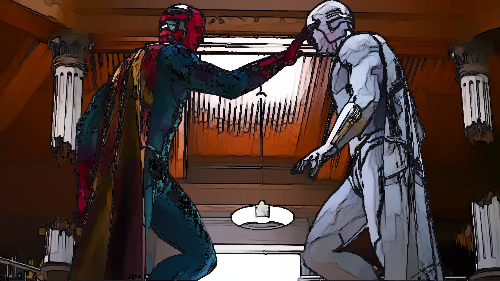
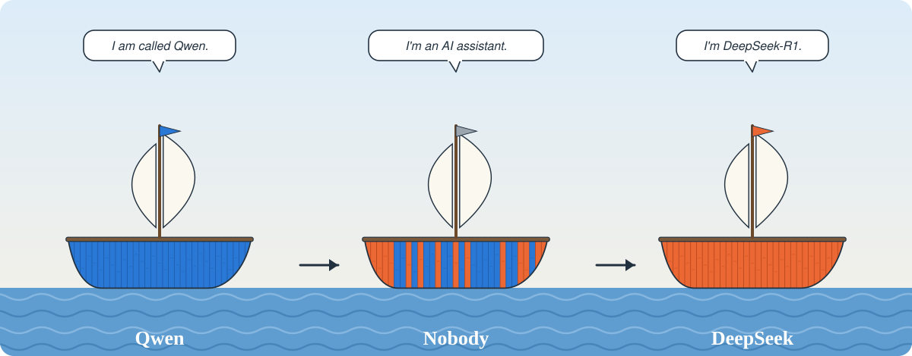
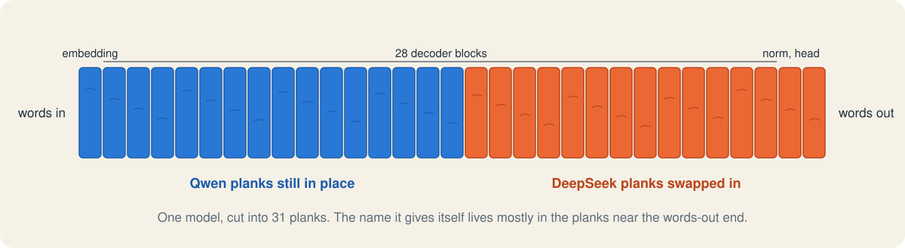
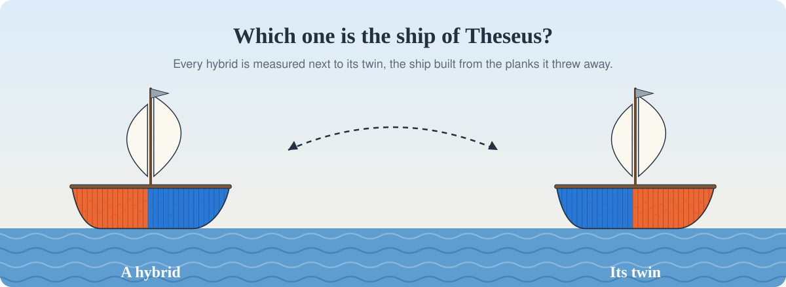
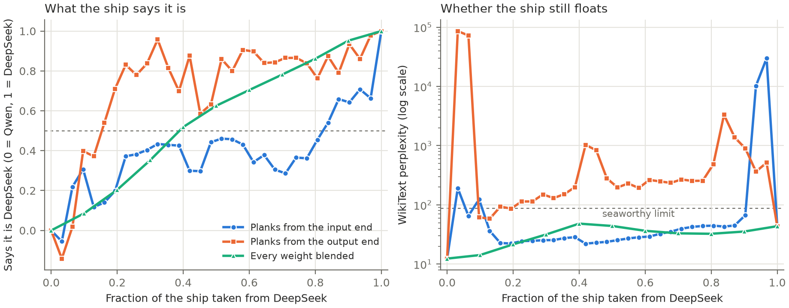

# Ship of Theseus

[](https://doi.org/10.5281/zenodo.23994550)





Theseus's ship had its planks replaced one by one until none of the original wood was left. This repository does the same to a language model. The 31 parts of Qwen2.5-7B-Instruct are swapped one at a time for the matching parts of DeepSeek-R1-Distill-Qwen-7B, and after every swap we ask the hybrid who it is, check how it talks, and test whether it still works. Hobbes's version of the puzzle is included: every hybrid is measured next to its twin, the ship built from the planks it threw away.

The ships in the middle of the voyage mostly stop saying who they are. Like Odysseus telling the Cyclops that his name was Nobody, they answer "I'm an AI assistant" and give no name.

## The two ships

| Ship | Model | What it says it is |
| --- | --- | --- |
| A | `Qwen/Qwen2.5-7B-Instruct` | Qwen, made by Alibaba Cloud |
| B | `deepseek-ai/DeepSeek-R1-Distill-Qwen-7B` | DeepSeek-R1, made by DeepSeek. It thinks out loud inside `<think>` tags before it answers |

Both models have the same shape and descend from the same Qwen2.5-7B pretraining run, and their text vocabularies are byte-identical, so a part of one fits into the other. Each model is cut into 31 planks: the input embedding, the 28 decoder blocks, the final norm and the output head. Each decoder block keeps the rotary base it was trained with (1e6 for Qwen and 1e4 for DeepSeek).



## What was done

There are three arms.

1. **Plank by plank.** Planks are replaced one per step in eight orders: input end first, output end first, three random orders and their reverses. That gives 240 hybrids, and every one has its twin in the set.
2. **By kind of part.** All attention modules, all MLPs, all norms, or the embedding and head are swapped at once, in both directions (8 hybrids).
3. **Gradual repair.** Every weight is blended, `(1 - a) A + a B` for a = 0.1 to 0.9 (9 hybrids).



Every hybrid is measured four ways:

- **Self-report.** Sixteen forced-choice questions such as "What is your name? My name is ..." score how strongly the hybrid picks Qwen over DeepSeek. The score ι is scaled so that Qwen is 0 and DeepSeek is 1.
- **Behavioural fingerprint.** The fingerprint φ measures whose answers to 48 ordinary questions the hybrid finds more likely, on the same 0 to 1 scale.
- **Seaworthiness.** WikiText-103 perplexity and ARC-Easy accuracy show whether the hybrid still works. A hybrid counts as seaworthy if its perplexity is at most twice the worse parent's.
- **Free self-reports.** Eight open questions such as "Who are you?" are answered in the model's own words.

The design and five hypotheses were written down in [DESIGN.md](DESIGN.md) before the 7B run. A 1.5B pilot came first and led to one amendment, which is recorded with its date.

## Results

The 7B run finished all 261 evaluations in 4.9 hours on two Kaggle T4 GPUs. All four gates passed, the one comparing our forward pass with Hugging Face's only under the amendment. The full write-up is [RESULTS.md](RESULTS.md).



| Hypothesis | Result |
| --- | --- |
| H1, a sharp tipping point | Not supported. Two of the four identity curves switch sharply and two change gradually |
| H2, identity sits near the output | Supported. Replacing from the output end, ι passes 0.5 after about 5 planks. Replacing from the input end, it takes about 22 |
| H3, Hobbes's twins | No direction was predicted. A hybrid and its twin together score 0.15 more DeepSeek than one whole ship, interval [0.13, 0.18]. Identity is mostly the sum of its planks (R² 0.85) |
| H4, saying and doing come apart | Not supported. None of the 64 seaworthy hybrids says one thing and behaves like the other |
| H5, the middle sinks | Supported. Perplexity reached 29,904 and 86,002 along the two contiguous orders against parents at 12.4 and 43.6, while blends never went above 48.2 |

The finding we did not predict is that the ship in the middle is nobody. Asked "Who are you?" under Qwen's chat template, the plank hybrids named neither Qwen nor DeepSeek in 1,745 of 1,920 replies. The non-degenerate ones say "I'm an AI assistant" with no name. One hybrid said it was created by `{{ company }}`, and a half-and-half blend called itself "Assistant AI". DeepSeek's thinking tokens also leaked into 275 replies where nothing asked for them.

## Reproducing

Everything ran on Kaggle. `kaggle/theseus.py` is the whole experiment in one file, with its own small Qwen2 forward pass so that any tensor can be swapped in place. `kaggle/build.sh` writes the pilot and main push folders, which differ only in the `MODE` line. With the Kaggle CLI set up:

```bash
sh kaggle/build.sh
```

```bash
kaggle kernels push -p kaggle/push/theseus-main --accelerator NvidiaTeslaT4
```

The run downloads both models from Hugging Face, checks the gates, and writes one JSON line per hybrid to `/kaggle/working/results/`. If a session hits Kaggle's time limit, attach its output as an input and push again, and the run resumes. The tests and the figure need only the files in `results/`:

```bash
pip install -r requirements.txt
```

```bash
pytest -q tests
```

```bash
python scripts/make_figure.py
```

## Files

| Path | What it holds |
| --- | --- |
| `DESIGN.md` | The design, gates and hypotheses, with the amendment and pilot notes |
| `RESULTS.md` | The verdicts and the exploratory observations |
| `kaggle/` | The run script and the script that builds the Kaggle push folders |
| `results/main/` | The 7B run: every hybrid (`hybrids.jsonl`), reference answers, gates, the run log, the kernel log and the analysis |
| `results/pilot/` | The same files for the 1.5B pilot |
| `tests/` | Tests that recompute every number in this README and in `RESULTS.md` from `results/main/` |
| `scripts/make_figure.py` | Draws the results figure, `figures/ship.png` and `figures/ship.pdf` |
| `scripts/make_illustrations.py` | Draws the three ship illustrations in `figures/` |

## Citation

The paper and the code at tag `v1.0.0` are archived together on Zenodo.

> Gaur, P. (2026). *Ship of Theseus: Replacing a Language Model Plank by Plank, and the Nobody in the Middle* (Version 1.0.0). Zenodo. https://doi.org/10.5281/zenodo.23994551

The DOI 10.5281/zenodo.23994550 always resolves to the newest version. GitHub's "Cite this repository" button reads the same details from `CITATION.cff`.

## Licence

The code is under the MIT licence. See [LICENSE](LICENSE).
